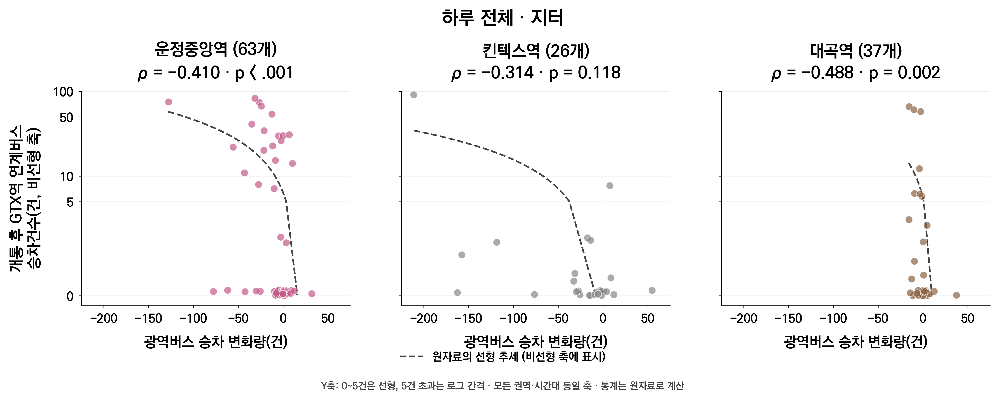
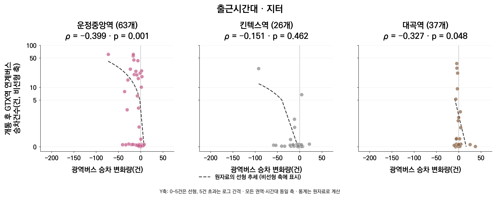

### 3.4 광역버스 승차 변화와 GTX역 연계버스 이용의 관계

앞선 분석에서는 광역버스 승차 변화와 관련 요인을 살펴보고, GTX역 연계버스가 어느 지역과 시간대에서 많이 이용되는지 확인하였다. 이 절에서는 두 지표를 같은 격자에서 연결하여, 광역버스 변화량이 낮은 지역에서 개통 후 연계버스 이용이 많은 경향이 나타나는지 살펴보았다.

#### 3.4.1 하루 전체·출근시간대 순위상관분석

전체 126개 격자를 대상으로 스피어만 순위상관분석을 수행하였다. 하루 전체 광역버스 승차 변화량에는 하루 전체 연계버스 승차건수를, 출근시간대 변화량에는 같은 시간대의 연계버스 승차건수를 연결하였다. 연계버스 이용이 없는 격자도 0건으로 포함하였다.

분석 결과, 하루 전체에서 ρ = −0.359, 출근시간대에서 ρ = −0.290으로 나타났으며 두 결과 모두 유의수준 5%에서 통계적으로 유의하였다(<표 28>). 즉, 광역버스 승차가 더 크게 감소하거나 증가폭이 작은 격자일수록 개통 후 GTX역 연계버스 이용이 많은 경향을 보였다.

| 시간대 | 격자 수 | 스피어만 상관계수(ρ) | p값 |
| --- | ---: | ---: | ---: |
| 하루 전체 | 126개 | -0.359 | < .001 |
| 출근시간대 | 126개 | -0.290 | < .001 |

표 28 광역버스 승차 변화량과 GTX역 연계버스 승차건수의 순위상관분석

두 지표의 격자별 분포는 <그림 19>와 같다. 가로축은 GTX-A 개통 후에서 개통 전을 뺀 광역버스 승차건수 변화량이며, 세로축은 개통 후 GTX역 연계버스 승차건수이다. 점 하나는 분석격자 하나를 나타낸다. 0건 격자도 포함하고, 겹치는 점을 구분하기 위해 표시 위치에만 작은 지터를 적용하였다. 세로축은 비선형 간격이며, 두 시간대와 모든 권역에 같은 축을 적용하였다. 상관계수와 점선으로 표시한 선형 추세는 원자료로 계산하였다.

그림 19 같은 격자에서의 광역버스 승차 변화량과 GTX역 연계버스 승차건수

#### 3.4.2 권역별 순위상관분석

연계버스 이용이 운정중앙역 권역에 집중되어 있다는 점을 고려하여, 각 권역 안에서도 두 지표의 관계를 확인하였다. 권역별 분석은 운정중앙역 63개, 킨텍스역 26개, 대곡역 37개 격자를 대상으로 수행하였다(<표 29>).

| 권역 | 격자 수 | 하루 전체 ρ | p값 | 출근시간대 ρ | p값 |
| --- | ---: | ---: | ---: | ---: | ---: |
| 운정중앙역 | 63개 | -0.410 | < .001 | -0.399 | 0.001 |
| 킨텍스역 | 26개 | -0.314 | 0.118 | -0.151 | 0.462 |
| 대곡역 | 37개 | -0.488 | 0.002 | -0.327 | 0.048 |

표 29 권역별 광역버스 승차 변화량과 GTX역 연계버스 승차건수의 순위상관분석

운정중앙역 권역은 하루 전체와 출근시간대 모두 유의한 음의 관계를 보였다. 대곡역 권역에서도 두 시간대 모두 유의한 음의 관계가 나타났다. 반면 킨텍스역 권역에서는 계수의 방향은 음이었으나 두 시간대 모두 유의수준 5%에서 관계가 확인되지 않았다. 전체에서 관찰된 음의 관계가 운정중앙역뿐 아니라 대곡역 내부에서도 나타났다는 점을 확인할 수 있다.

대곡역은 출근시간대 광역버스 승차건수가 권역 전체에서 39건 증가했지만, 권역 내부에서는 광역버스 변화량이 낮은 격자일수록 연계버스 이용이 많은 경향을 보였다. 따라서 권역 전체의 증가·감소와 같은 권역 안의 격자별 관계를 함께 살펴볼 필요가 있다.

#### 3.4.3 하루 전체와 출근시간대의 관계 비교

하루 전체와 출근시간대 모두 광역버스 변화량과 GTX역 연계버스 이용 사이에 음의 관계가 나타났다. 권역별로도 운정중앙역과 대곡역은 두 시간대 모두 유의하였고, 킨텍스역은 두 시간대 모두 유의하지 않았다. 시간대별 이용 규모와 권역 비중에는 차이가 있었지만, 두 지표가 연결되는 방향에는 공통점이 있었다.

이 결과는 광역버스 승차 변화와 GTX역으로 향하는 버스 이용이 같은 공간에서 관련되어 나타났음을 보여준다. 기존 광역버스 통행의 일부가 GTX 연계통행으로 전환되었을 가능성을 살펴볼 간접 근거로 활용할 수 있다. 다만 순위상관에는 역 접근성과 인구·토지이용 등 다른 지역 특성의 영향도 함께 반영될 수 있으며, 기존 이용자가 실제로 GTX를 탔는지를 확인한 결과는 아니다.

특히 운정중앙역과 대곡역은 광역버스의 권역별 증감 방향이 다르면서도, 두 시간대 모두 권역 내부에서 음의 관계를 보였다. 다음 장에서는 두 권역의 보행시간 구간별 이용과 현장답사 내용을 연결하여, 서로 다른 접근·환승 여건에서 이러한 결과가 어떻게 나타났는지 살펴보았다.
